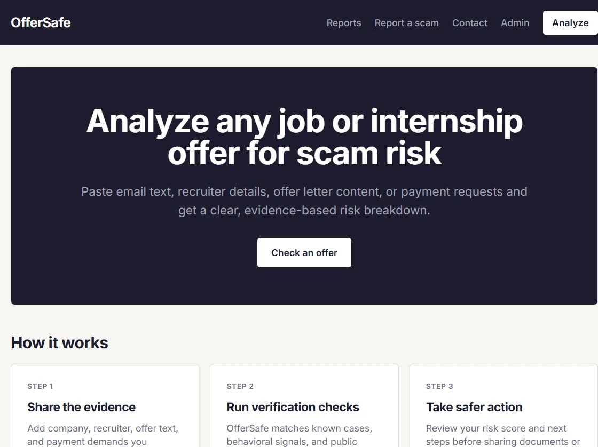

# OfferSafe

Scam risk analyzer for job and internship offers. Built for students and job seekers in India who want to verify an offer before sharing documents or sending money.

Live: https://offer-safe.vercel.app



---

## What it does

You paste in whatever you received — recruiter message, offer letter, payment request, company details — and it gives you an evidence-based risk score. It also cross-references against community-reported scam cases, so if someone else already reported the same company or recruiter, it'll catch that too.

There's also a public scam reports page where anyone can browse or submit known cases.

---

## Stack

- Next.js 14 + TypeScript
- Supabase — database and auth
- Gemini API + Groq API — AI risk analysis
- Resend — email
- Tailwind CSS
- Deployed on Vercel

---

## Running locally

```bash
git clone https://github.com/Ronack-Kumar/OfferSafe.git
cd OfferSafe
npm install
cp .env.local.example .env.local
```

Fill in `.env.local`:

```
NEXT_PUBLIC_SUPABASE_URL=
NEXT_PUBLIC_SUPABASE_ANON_KEY=
GEMINI_API_KEY=
GROQ_API_KEY=
RESEND_API_KEY=
```

Run migrations from `supabase/migrations/`, then:

```bash
npm run dev
```

---

*Not legal advice. For awareness only.*
